<div align="center">

# 🩺 MediIQ — AI-Native Telemedicine Platform

**Healthcare that reasons with you.**

MediIQ pairs a real clinician with a **9-agent AI pipeline**, **camera-based vitals (rPPG)**, and **instant, safety-checked medical reports** — telemedicine reimagined for the AI era.

[](https://nextjs.org)
[](https://react.dev)
[](https://www.typescriptlang.org)
[](https://tailwindcss.com)
[](https://www.mongodb.com/atlas)
[](https://vercel.com)

🔗 **Live demo:** [medi-iq-advanced.vercel.app](https://medi-iq-advanced.vercel.app)

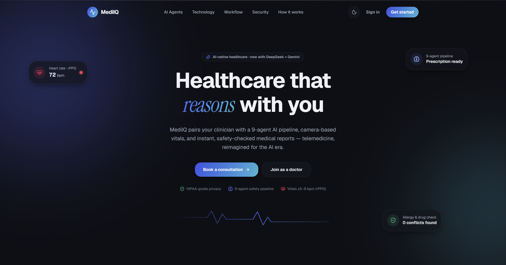

</div>

---

## 📖 Table of Contents

- [What is MediIQ?](#-what-is-mediiq)
- [Key Features](#-key-features)
- [Screenshots](#-screenshots)
- [The 9-Agent AI Pipeline](#-the-9-agent-ai-pipeline)
- [Camera-Based Vitals (rPPG)](#-camera-based-vitals-rppg)
- [Pluggable AI Engine](#-pluggable-ai-engine)
- [Tech Stack](#-tech-stack)
- [Architecture & Flow](#-architecture--flow)
- [Project Structure](#-project-structure)
- [Getting Started](#-getting-started)
- [Environment Variables](#-environment-variables)
- [Roles](#-roles)
- [Disclaimer](#-disclaimer)

---

## 🧠 What is MediIQ?

MediIQ is a full-stack telemedicine platform where a patient books a live video consultation with a real doctor — but every step is augmented by a chain of specialised AI agents that gather context, retrieve medical evidence, draft a prescription, and run automated drug-interaction and allergy safety checks **before the doctor ever writes the final Rx**.

The doctor stays fully in control: the AI does the heavy lifting (summarising history, finding similar cases, transcribing the call, drafting a safety-checked prescription), and the doctor reviews, edits, and signs off. Nothing reaches the patient without a human in the loop.

It serves **three roles** — Patients, Doctors, and Admins — each with a dedicated, fully responsive dashboard, light/dark theming, and a modern motion-driven UI.

---

## ✨ Key Features

| | Feature | Description |
|---|---|---|
| 🤖 | **9-agent clinical pipeline** | Patient summary → transcription → similar-case retrieval → medical-context (ICD-10/MedlinePlus) → allergy expansion → AI prescribing → drug-interaction check → allergy safety check → finding detection. |
| 📹 | **Live video consultations** | Real-time doctor↔patient video powered by Agora RTC, with a Socket.IO signalling layer for call state, approvals, and notifications. |
| ❤️ | **Camera-based vitals** | Contactless **blood pressure & heart rate** estimation from a 30-second face video using remote photoplethysmography (rPPG). |
| 💊 | **Safety-checked prescriptions** | Every AI-drafted prescription is automatically screened for drug–drug interactions (DDInter/openFDA) and allergy violations (RxClass) with an automatic re-prescribe loop. |
| 📄 | **Printable prescription PDF** | Clean, branded, signature-embedded medical prescription generated with `@react-pdf/renderer`. |
| 🔍 | **Vector-powered case retrieval** | MongoDB Atlas vector search over an anonymised case library using Gemini embeddings, with demographic re-ranking. |
| 💬 | **Post-consultation assistant** | An in-app chatbot for patients to ask about their medicines, symptoms, and side-effects after the visit. |
| 📊 | **Outbreak & analytics monitor** | Admin dashboard with anonymised disease intelligence — consultation volume, top symptoms, severity split, and AI-assisted analysis. |
| ⚙️ | **Pluggable AI engine** | Admin-controlled global LLM mode: Gemini, DeepSeek, Ollama, or hybrid — switchable at runtime. |
| 🌗 | **Modern, themed UI** | Design-system-driven interface with light/dark mode, framer-motion animations, an app shell, and a command palette. |

---

## 📸 Screenshots

### Landing & Patient Experience

| Landing page | Patient dashboard |
|---|---|
|  | 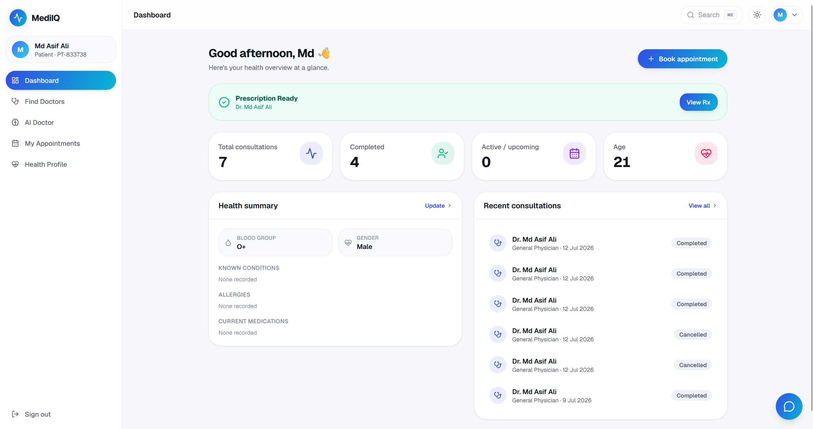 |

| Pre-consultation form | Post-consultation assistant |
|---|---|
| 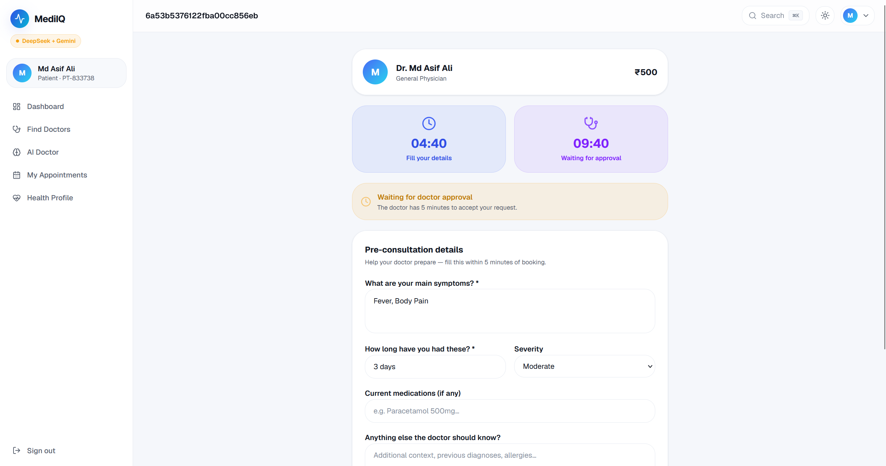 | 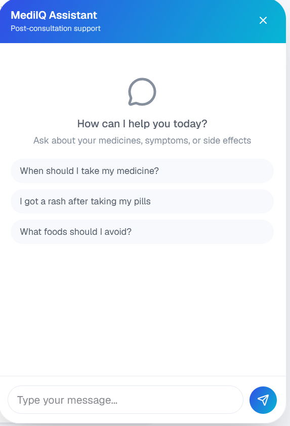 |

### Doctor Experience

| Doctor dashboard | In-call AI patient panel |
|---|---|
| 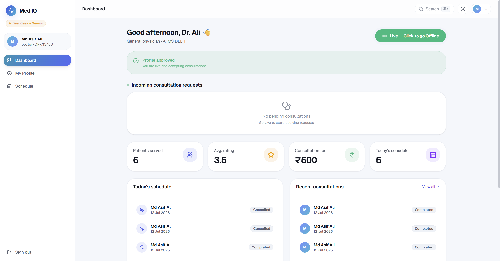 | 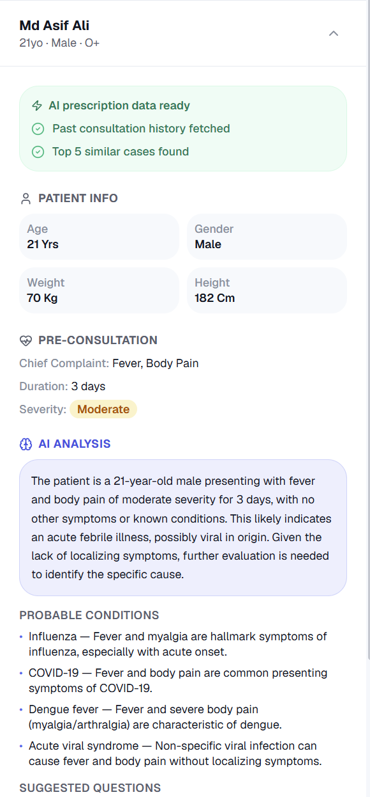 |

**Post-call agent pipeline** — the doctor watches the 9-agent pipeline run to completion, then reviews the structured outputs and the AI-drafted prescription:

| Pipeline progress | Agent outputs (readable) |
|---|---|
| 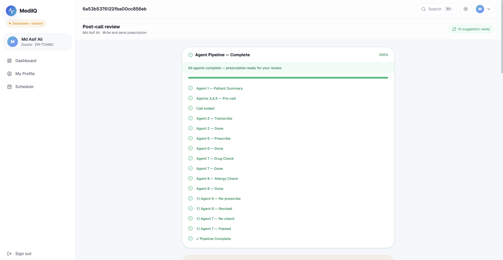 | 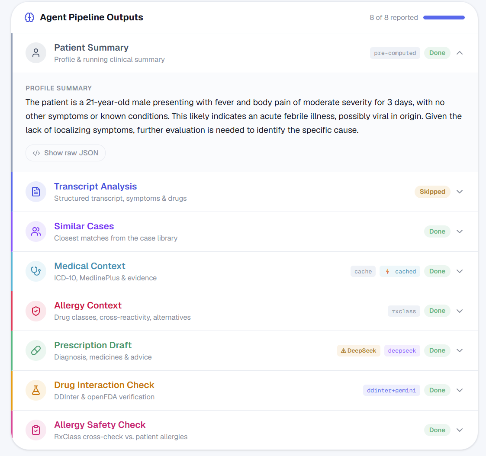 |

| Prescription editor | Final prescription PDF |
|---|---|
| 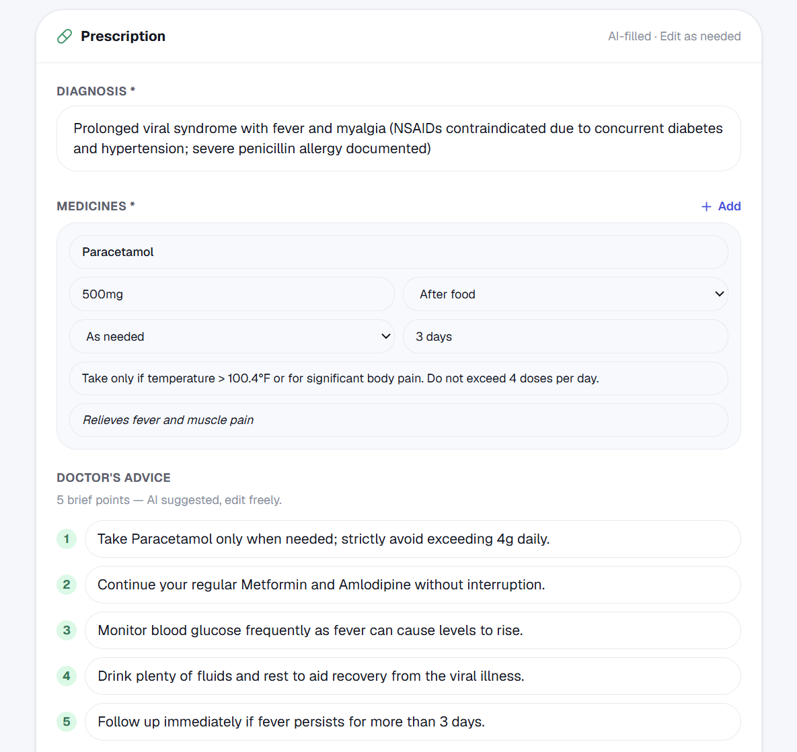 | 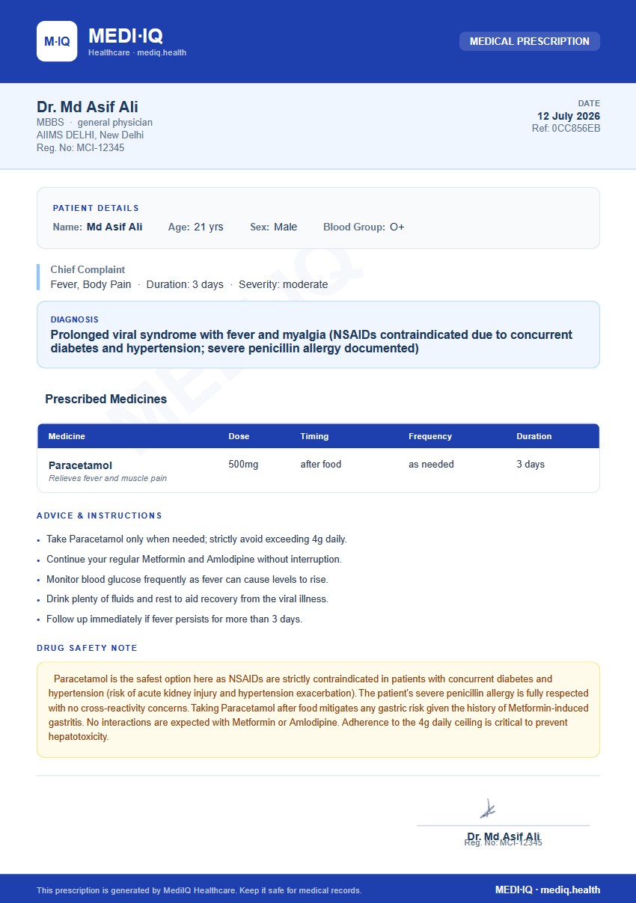 |

### Admin

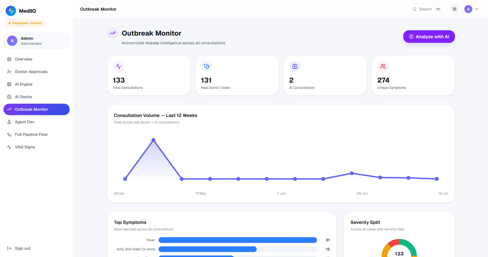

---

## 🔗 The 9-Agent AI Pipeline

The heart of MediIQ. Agents run at three moments: **on profile save**, **when the patient locks their pre-consultation details** (agents 3–5 pre-warm in the background), and **after the call ends** (the reasoning + safety chain).

| # | Agent | Role | Data sources |
|---|---|---|---|
| **1** | **Patient Summary** | Builds a profile summary + a running clinical summary from past consultations. | Patient profile, consultation history |
| **2** | **Transcribe** | Structures the raw call transcript; extracts symptoms, medications & allergies; normalises drug names. | Call transcript, RxNorm |
| **3** | **Similar Cases** | Retrieves the closest historical cases via vector search + demographic re-ranking. | Atlas vector search, Gemini embeddings |
| **4** | **Medical Context** | Resolves ICD-10 codes and pulls evidence & condition summaries. | ICD-10 (NIH), MedlinePlus, openFDA |
| **5** | **Allergy Context** | Expands known allergies into drug classes and flags cross-reactivity + safe alternatives. | RxClass, RxNorm |
| **6** | **Reasoning / Prescribe** | The **prescriber** — synthesises everything into a diagnosis, medicines, advice & a drug-safety note. | All upstream agents |
| **7** | **Drug Interaction Check** | Verifies the draft for drug–drug interactions & dosing. | DDInter, openFDA |
| **8** | **Allergy Safety Check** | Cross-checks every prescribed drug against the patient's allergy classes. | RxClass |
| **9** | **Finding Detector** | Surfaces newly detected allergies / lifelong medications for the patient record. | Pipeline output |

**Safety loop:** if Agent 7 or 8 flags a drug, the pipeline loops back to Agent 6 to re-prescribe safe alternatives (up to 2 passes) before escalating anything unresolved to the doctor. Flagged drugs are never sent to the patient.

> The agent-outputs panel (screenshot above) renders each agent's result in a readable, structured view — with provider badges (`gemini` / `deepseek` / `ollama`), cache indicators, and a raw-JSON escape hatch.

---

## ❤️ Camera-Based Vitals (rPPG)

MediIQ estimates **blood pressure and heart rate from a short face video** — no wearable required — using remote photoplethysmography, which reads the micro colour changes in facial skin caused by blood flow.

- **Production:** a POS (Plane-Orthogonal-to-Skin) signal-processing pipeline running on MediaPipe face landmarks.
- **Research/lab:** deep-learning rPPG models (PhysNet / EfficientPhys-family) live in the `ml/` directory for experimentation and benchmarking.
- **Accuracy:** heart rate within roughly **±5–8 bpm** under good lighting.

The captured vitals attach to the pre-consultation so the doctor and Agent 6 have them at prescribing time.

---

## ⚙️ Pluggable AI Engine

The global LLM backend is **admin-controlled at runtime** (`/admin/ai-mode`) with four modes:

| Mode | Behaviour |
|---|---|
| **Gemini Only** | All agents use Google Gemini. |
| **DeepSeek Only** | All agents use DeepSeek (v4 Flash, via the OpenCode Zen hosted API). |
| **Gemini + Ollama** | Hybrid — the prescriber (Agent 6) prefers Gemini; other agents use Ollama. |
| **DeepSeek + Gemini** | Hybrid — the prescriber prefers Gemini (parallel race, 60s window); other agents use DeepSeek. |

In hybrid modes, Gemini is reserved for the critical **prescriber** step, running in parallel with the secondary model and preferring Gemini if it answers in time. **Embeddings always use Gemini** (`gemini-embedding-001`) — a permanent exception, since Atlas vector search needs those embeddings.

---

## 🛠 Tech Stack

**Framework & UI**
- Next.js 16 (App Router) · React 19 · TypeScript 5
- Tailwind CSS v4 (`@theme` tokens, custom dark variant) · framer-motion v12
- lucide-react icons · react-hot-toast

**Backend & Data**
- Custom Node server (`server.ts` via `tsx`) with **Socket.IO** for realtime signalling
- MongoDB Atlas + Mongoose 9 (incl. **Atlas Vector Search**)
- JWT auth (`jsonwebtoken`) + `bcryptjs`

**Real-time & Media**
- Agora RTC SDK + `agora-token` for video calls
- `@react-pdf/renderer` for prescription PDFs
- `@mediapipe/tasks-vision` for face-landmark rPPG vitals

**AI & Medical Data**
- Google Gemini (`@google/generative-ai`) · OpenAI-compatible client for DeepSeek/Ollama (`openai`)
- Medical APIs: ICD-10 (NIH), MedlinePlus, RxNorm, RxClass, DDInter, openFDA
- Python ML service for rPPG (`ml/`)

---

## 🏗 Architecture & Flow

```
Patient books ──► Pre-consultation form ──► 🔒 Lock details
                                              │
                                              ▼  (background)
                                    Agents 3, 4, 5 pre-warm
                                              │
Doctor approves ──► Live video call (Agora + Socket.IO)
                                              │
                                     Call ends ──► post_call
                                              │
                        Agent 2 (transcribe, if audio) ──► Agent 6 (prescribe)
                                              │
                              Agent 7 + Agent 8 verify ──┐
                                              │          │ flagged?
                                              ▼          ▼
                              Agent 9 findings   loop back to Agent 6 (<= 2x)
                                              │
                        Doctor reviews & edits ──► Signs & sends Rx ──► Patient
```

The app runs a single custom server (`server.ts`) that hosts both the Next.js app and the Socket.IO server, so call state, doctor approvals, and live notifications propagate instantly.

---

## 📁 Project Structure

```
app/
├── (auth)/            # Login & register
├── patient/           # Dashboard, booking, pre-consultation, consultation, AI consult, profile
├── doctor/            # Dashboard, appointments, consultation, post-call review, profile
├── admin/             # Overview, doctor approvals, AI engine, AI doctor, analytics, dev tools
└── api/               # Route handlers (appointments, auth, chat, doctors, patient, admin, ai-consultation…)

components/            # UI kit, app shell, consultation panels, motion helpers, vitals modal, landing sections
lib/
├── agents/            # agent1–9, pipeline.ts, llm.ts (mode routing), demo-cache, registry, types
├── models/            # Mongoose models (User, DoctorProfile, PatientProfile, Appointment, Case, agent caches…)
├── auth.ts            # JWT sign/verify + getCurrentUser
├── mongodb.ts         # Serverless-safe cached connection
└── gemini.ts          # Embeddings + Gemini helpers

ml/                    # Python rPPG vitals (models, api, src, test videos)
server.ts              # Custom Next.js + Socket.IO server
```

---

## 🚀 Getting Started

### Prerequisites
- Node.js 20+
- A MongoDB Atlas cluster (with a vector search index for the case library)
- API keys (see [Environment Variables](#-environment-variables))

### Install & run

```bash
# 1. Install dependencies
npm install

# 2. Create your environment file and fill in the values below
#    (create .env.local in the project root)

# 3. Seed an admin account
npm run seed:admin

# 4. Start the dev server (Next.js + Socket.IO)
npm run dev
```

Open [http://localhost:3000](http://localhost:3000).

```bash
npm run build   # production build
npm run start   # production server
npm run lint    # eslint
```

---

## 🔐 Environment Variables

Create a `.env.local` in the project root:

```env
# Database
MONGODB_URI=your-mongodb-atlas-connection-string

# Auth
JWT_SECRET=your-long-random-secret

# AI providers
GEMINI_API_KEY=your-gemini-key
DEEPSEEK_API_KEY=your-opencode-zen-key      # DeepSeek v4 Flash via OpenCode Zen
OLLAMA_BASE_URL=http://localhost:11434       # optional, for local Ollama mode

# Video (Agora)
NEXT_PUBLIC_AGORA_APP_ID=your-agora-app-id
AGORA_APP_CERTIFICATE=your-agora-certificate
```

> On Vercel, the long-running agent pipeline routes rely on `maxDuration` (up to 300s on Pro; the Hobby tier caps functions at 60s).

---

## 👥 Roles

- **Patient** — completes their health profile, books live consultations, fills a pre-consultation form, does an optional camera vitals scan, joins the video call, receives a safety-checked prescription, and chats with the post-consultation assistant.
- **Doctor** — goes "Live" to accept requests, reviews an AI patient briefing during the call, then in post-call review watches the pipeline, edits the AI-drafted prescription, and signs & sends it.
- **Admin** — approves doctors, switches the global AI engine mode, monitors anonymised outbreak analytics, and inspects the agent pipeline via developer tools.

---

## ⚠️ Disclaimer

MediIQ is a portfolio / research project demonstrating an AI-augmented telemedicine workflow. It is **not a certified medical device** and must not be used for real clinical decision-making. All AI output is intended to assist a licensed clinician who remains fully responsible for every prescription.

---

<div align="center">

Built with Next.js, MongoDB, and a lot of AI agents.

</div>
